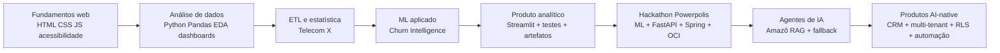

<div align="center">

# Portfólio · Lídi Moura

**AI & Data Builder** · Analista de Dados e IA aplicada · Solutions Architect · CEO do Hub Encontro d'água

*Transformo dados e modelos em produtos demonstráveis, com visão de usuário, Customer Success e impacto social.*

[](https://github.com/lidimoura)
[](https://www.linkedin.com/in/lidimoura/)
[](https://link.encontrodagua.com/r/portifolio-lidimoura)
[](https://github.com/lidimoura/encontro-dagua-hub)
[](https://cursos.alura.com.br/emprega-one/profile/lidimfc)

</div>

> **Status:** inventário de 11/10/2026 · última revisão em 12/10/2026.
> Este documento é um mapa. A fonte de verdade de cada projeto é o próprio repositório (README e código).

---

## Selos e certificações

<div align="center">


</div>

### Ecossistema (logos)

<div align="center">


&nbsp;&nbsp;

&nbsp;&nbsp;

&nbsp;&nbsp;

&nbsp;&nbsp;

&nbsp;&nbsp;

&nbsp;&nbsp;

&nbsp;&nbsp;
<a href="https://cursos.alura.com.br/emprega-one/profile/lidimfc"></a>

</div>

---

## Formação e certificações

| Certificação / programa | Instituição | Status |
|---|---|---|
| **OCI Foundations Associate** | Oracle | Certificada |
| **OCI AI Foundations Associate** | Oracle | Certificada |
| **Análise de Dados com Power BI** (destaque) | Fundação Bradesco | Concluído |
| Introdução à Análise de Dados | Fundação Bradesco | Concluído |
| IA na Prática: Como Dados bem Estruturados fazem a Diferença | Fundação Bradesco | Concluído |
| **Programa ONE, com especialização em Data Science** | Alura + Oracle | Graduada |
| **ONE G9** | Alura + Oracle + No Country | Concluído · **1º lugar no Hackathon**, como líder técnica da equipe |
| ONE G10 · AI for Tech | Alura + Oracle | Em andamento |
| ONE G11 · Tech for Business | Alura + Oracle | Em andamento |
| Parceira Oficial Certificada | Kommo CRM | Ativa |
| Psicologia | UFAM (2009–2014) | Graduada |

---

## Trajetória completa na Alura (EmpregaONE)

[](https://cursos.alura.com.br/emprega-one/profile/lidimfc)
[](https://cursos.alura.com.br/user/lidimfc/fullCertificate/4c9d02659d43e963f3c83cc7e0127919)

| 56 | 10 | 4 |
|:---:|:---:|:---:|
| cursos concluídos | trilhas concluídas | projetos no portfólio |

O perfil no EmpregaONE (Oracle Next Education + Alura) reúne todos os certificados, trilhas e projetos, com data de conclusão e link de verificação.

**Trilhas concluídas, por área**

| Área | Trilhas |
|---|---|
| Dados e ML | Fundamentos de Python e Dados G9 · Aprendendo a fazer ETL (G8 e G9) · Estatística e Machine Learning G9 |
| Cloud / OCI | Jornada de certificação OCI Foundations Associate · Oracle Cloud Infrastructure (ONE AI for Tech) · OCI AI Foundations Associate |
| Base e carreira | Iniciante em Programação G9 · Desenvolvimento Pessoal G9 · Empreendedorismo, Agilidade e Protagonismo na Carreira G9 |

**Cursos que sustentam os projetos**

- **Dados:** Pandas (4 cursos), NumPy, Estatística com Python (2), Classificação com Scikit-learn, Regressão Linear (2), Data Visualization (2), Modelagem de dados, IA aumentada: prevendo atrasos de voos.
- **IA e agentes:** Flash Skills: Agentes de IA com LangGraph · Challenge Alura Agente (RAG) · Engenharia de Prompt · IA aplicada a Data Science.
- **Cloud e infraestrutura:** OCI: implantação de aplicação na nuvem · OCI: banco de dados e infraestrutura como código · Oracle Autonomous Database · Low Code e IA com Oracle Apex · DevOps: Linux CLI e tráfego seguro.

**Projetos publicados no EmpregaONE**

| Projeto | Stack |
|---|---|
| [Equipe campeã do Hackathon G9 BR · EnergiAI](https://cursos.alura.com.br/emprega-one/project/2861) | API REST, Pandas, Machine Learning, Python |
| [Alura Store · Data analytics & insights strategist](https://cursos.alura.com.br/emprega-one/project/2844) | Python, Pandas, Matplotlib, TypeScript |
| [Pesquisa de Satisfação + Dashboard Interativo](https://cursos.alura.com.br/emprega-one/project/2864) | Python, Pandas, Matplotlib |
| [Base de Conhecimento: Turismo regional & TBC Manaus](https://cursos.alura.com.br/emprega-one/project/2843) | API REST, Java, Node.js, JSON |

---

## Posicionamento

Analista de Dados e IA aplicada com experiência prática em transformar dados e modelos em produtos demonstráveis. Uno **Python, ETL, EDA, Machine Learning, dashboards, APIs REST, OCI, RAG e automação** a uma visão de negócio, UX e relacionamento com clientes, resultado de uma formação em Psicologia e mais de 10 anos em Customer Success.

**Diferenciais**

- **1º lugar no Hackathon ONE G9 BR**, como **líder técnica** do time G9-BR-TEAM-12.
- Certificada em **OCI Foundations Associate** e **OCI AI Foundations Associate**, com certificação em **Power BI** pela Fundação Bradesco.
- Conexão completa entre **modelo preditivo, API, frontend, Docker e OCI**.
- Projetos de dados com artefatos reproduzíveis, testes automatizados e atenção à LGPD.
- Evolução de chatbot/SDR para **agente RAG com citações, fallback e rastreabilidade**.
- Produto real: **CRM AI-first multi-tenant**, com RBAC/RLS, trial, QR Codes e agentes de IA.
- Capacidade de traduzir análise técnica em recomendação executiva.

---

## Palavras-chave

<details open>
<summary><b>Dados e Analytics</b></summary>

`Data Analytics` · `Análise de Dados` · `Data Science` · `ETL` · `EDA` · `Estatística Aplicada` · `Visualização de Dados` · `Dashboards` · `Power BI` · `KPIs` · `Business Intelligence` · `Storytelling com Dados`

</details>

<details open>
<summary><b>Machine Learning e IA</b></summary>

`Machine Learning` · `Scikit-learn` · `Random Forest` · `Regressão Logística` · `SMOTE` · `Churn` · `LLMs` · `RAG` · `Embeddings` · `LangChain` · `LangGraph` · `Agentes de IA` · `Prompt Engineering` · `Fallback Multi-LLM`

</details>

<details open>
<summary><b>Engenharia e Cloud</b></summary>

`Python` · `Pandas` · `NumPy` · `SQL` · `PostgreSQL` · `FastAPI` · `API REST` · `Docker` · `Oracle Cloud (OCI)` · `Supabase` · `React` · `TypeScript` · `Streamlit` · `Plotly` · `n8n` · `Pytest` · `Oracle APEX` · `Linux` · `Git/GitHub`

</details>

<details open>
<summary><b>Produto, Negócio e Segurança</b></summary>

`CRM` · `Kommo` · `Customer Success` · `UX` · `Product Thinking` · `Multi-tenant` · `RBAC` · `RLS` · `LGPD` · `Automação de Processos` · `Liderança de Equipe` · `Comunicação Técnica`

</details>

<details>
<summary><b>Em formação</b></summary>

`Tableau` · `Certificações OCI de nível avançado` · `MySQL`

</details>

<details>
<summary><b>Idiomas</b></summary>

Português · Inglês · Espanhol

</details>

---

## Stack


---

## Evolução em uma imagem



> Não são notebooks isolados: é uma progressão de **insight** para **produto**, e de **produto** para **sistema operacional AI-native**.

---

## Se você é recrutador(a): comece por aqui

| Vaga | Projetos para ver primeiro |
|---|---|
| **Analista de Dados / BI** | [Alura Store](https://github.com/lidimoura/challenge1-data-science-Alura-Store) · [Telecom X2](https://github.com/lidimoura/challenge3-data-science-TelecomX2) · [Imersão Dados (salários)](https://github.com/lidimoura/imersao-dados-python-alura) · [Pesquisa de satisfação](https://github.com/lidimoura/pesquisa-satisfacao-showcase) · [VoeBem ANAC](https://github.com/lidimoura/projeto-voebem-anac) |
| **Data Scientist / ML aplicado** | [Powerpolis](https://github.com/No-Country-simulation/G9-BR-TEAM-12) · [Telecom X2](https://github.com/lidimoura/challenge3-data-science-TelecomX2) · [Telecom X](https://github.com/lidimoura/challenge2-dataScience-TelecomX) · [VoeBem ANAC](https://github.com/lidimoura/projeto-voebem-anac) |
| **AI Engineer / LLM / RAG** | [Amazô.guia G10](https://github.com/lidimoura/amazo-guia-g10) · [Hub Digital](https://github.com/lidimoura/encontro-dagua-hub-digital) · [Encontro d'água Hub](https://github.com/lidimoura/encontro-dagua-hub) · [Powerpolis](https://github.com/No-Country-simulation/G9-BR-TEAM-12) |
| **Full-stack AI / Solutions Engineer** | [Hub Digital](https://github.com/lidimoura/encontro-dagua-hub-digital) · [Powerpolis](https://github.com/No-Country-simulation/G9-BR-TEAM-12) · [Amazô.guia](https://github.com/lidimoura/amazo-guia-g10) · [Showcase G10](https://github.com/lidimoura/amazo-g10-showcase) |
| **CS técnico / Solutions Consultant / RevOps** | [Hub Digital](https://github.com/lidimoura/encontro-dagua-hub-digital) · [Amazô.guia](https://github.com/lidimoura/amazo-guia-g10) · [Pesquisa de satisfação](https://github.com/lidimoura/pesquisa-satisfacao-showcase) · [Synkbot](https://github.com/lidimoura/Assistente-Synkbot-v2) |

---

## Cases em destaque

### 1. Powerpolis / EnergiAI · Liderança, dados, ML, API e OCI

**Hackathon ONE G9 (Alura + Oracle + No Country) · 1º lugar · Líder técnica** · [Repositório](https://github.com/No-Country-simulation/G9-BR-TEAM-12)

**Problema:** ajudar residências e pequenos estabelecimentos a entender o consumo de energia, classificar a eficiência e receber recomendações práticas.

**Solução:** a aplicação recebe dados de consumo, classifica o perfil (eficiente, moderado ou ineficiente), estima o custo mensal e gera recomendações.

**Arquitetura:** React + Vite (frontend) · Java 21 + Spring Boot (orquestração) · Python + FastAPI (serviço de IA) · Docker Compose + OCI (Object Storage, Autonomous Database, Vault).

**Resultados documentados:** dataset determinístico de 50.000 registros simulados · Random Forest com 61,94% de acurácia no teste · comparação com Regressão Logística e Árvore de Decisão · limiares por quartil dentro de cada tipo de imóvel · teste ponta a ponta · endpoint `POST /analise-energetica`.

**Minha contribuição:** liderança técnica da equipe · análise do problema e definição da solução · papel de Data Analyst / Data Scientist · API REST do modelo preditivo · integração e configuração OCI (Object Storage, Vault, Compartments, Autonomous AI Database) · participação na arquitetura com backend e frontend · defesa no Demo Day · narração do vídeo oficial de pitch.

---

### 2. Amazô.guia G10 · IA aplicada, RAG e resiliência

[Repositório](https://github.com/lidimoura/amazo-guia-g10) · [App](https://amazo-guia-g10.streamlit.app/) · [Showcase](https://github.com/lidimoura/amazo-g10-showcase)

Agente SDR-RAG e guia digital do Hub, desenvolvido no Challenge G10 (AI for Tech).

```
Usuário → Streamlit Chat → busca semântica → InMemoryVectorStore
        → all-MiniLM-L6-v2 (fallback TF-IDF)
        → contexto + fontes
        → Groq gpt-oss-120b → Groq gpt-oss-20b → OpenAI gpt-4o-mini
```

**Diferenciais:** respostas ancoradas em fontes autorizadas, com citações e rastreabilidade · fallback neural para TF-IDF · fallback multi-provedor de LLM · ambiente fixado em Python 3.11 · caderno de evidências separado do MVP.

---

### 3. Encontro d'água Hub Digital · Produto, multi-tenancy e segurança

[Repositório](https://github.com/lidimoura/encontro-dagua-hub-digital)

Ecossistema de gestão com IA: CRM multi-tenant, bilíngue e orientado a LGPD.

**Documentado no README:** Kanban multi-board com squad de IA · contatos e deals isolados por `company_id` · catálogo, contratos e precificação · QR d'água e bridge pages · relatórios de pipeline e win/loss · Amazô como agente CS/SDR · Prompt Lab · trial público de 7 dias · circuit breaker para limites de API · moedas BRL/USD/AUD.

**Stack:** React 18 · TypeScript · Vite · Tailwind · Supabase (PostgreSQL, Auth, Edge Functions) · Gemini, OpenAI, Anthropic · Vercel.

**Maturidade de engenharia:** RLS baseado em claims JWT · proteção por rota e perfil · migrations documentadas · DEVLOG, QA checklist e guias de usuário.

---

### 4. Telecom X2 · Método analítico

[Repositório](https://github.com/lidimoura/challenge3-data-science-TelecomX2)

Previsão de churn e priorização de ações de retenção. Pipeline com limpeza, deduplicação, encoding, SMOTE dentro do pipeline de treino, comparação de modelos, validação cruzada, artefatos JSON/CSV e dashboard executivo.

- 7.043 registros originais · 22 duplicidades removidas · 7.021 clientes analíticos · churn de 26,45%.
- Regressão Logística escolhida por priorizar recall: recall 76,12% · F1 61,81% · AUC 0,835.
- Random Forest: acurácia 78,36% · precisão 58,24%.
- Qualidade: `pytest`, auditoria de hardcoding, relatório técnico e a ressalva explícita de que score não implica causalidade.

---

## Todos os projetos

| Projeto | Categoria | Stack / temas |
|---|---|---|
| [Powerpolis / EnergiAI](https://github.com/No-Country-simulation/G9-BR-TEAM-12) | Hackathon, ML, cloud e produto | Python, Scikit-learn, FastAPI, Java 21, Spring Boot, React, Docker, OCI |
| [encontro-dagua-hub-digital](https://github.com/lidimoura/encontro-dagua-hub-digital) | Produto AI-native | React, TypeScript, Supabase, PostgreSQL, RLS, Gemini/OpenAI/Anthropic, Vercel |
| [amazo-guia-g10](https://github.com/lidimoura/amazo-guia-g10) | Agente de IA e RAG | Python, Streamlit, LangChain, Groq, OpenAI, HuggingFace, TF-IDF |
| [Telecom X2](https://github.com/lidimoura/challenge3-data-science-TelecomX2) | Data Science e ML | Pandas, NumPy, Scikit-learn, SMOTE, Plotly, Streamlit, Pytest |
| [Alura Store](https://github.com/lidimoura/challenge1-data-science-Alura-Store) | Analytics e decisão executiva | Pandas, Matplotlib, Seaborn, Plotly, Streamlit |
| [encontro-dagua-hub](https://github.com/lidimoura/encontro-dagua-hub) | Arquitetura de agentes | FastAPI, Streamlit, n8n, Supabase, LangChain, ChromaDB |
| [amazo-g10-showcase](https://github.com/lidimoura/amazo-g10-showcase) | Documentação técnica | React/Vite/Tailwind, GitHub Pages |
| [imersao-dados-python-alura](https://github.com/lidimoura/imersao-dados-python-alura) | Analytics e BI | Pandas, Plotly, Streamlit, Colab |
| [Telecom X](https://github.com/lidimoura/challenge2-dataScience-TelecomX) | ETL e EDA | Pandas, Plotly, Scikit-learn |
| [pesquisa-satisfacao-showcase](https://github.com/lidimoura/pesquisa-satisfacao-showcase) | Coleta, análise e dashboard | Tally, Pandas, Colab, Streamlit |
| [projeto-voebem-anac](https://github.com/lidimoura/projeto-voebem-anac) | Engenharia de dados | Databricks, pipeline, EDA, dados públicos da ANAC |
| [amazo.ia-showcase](https://github.com/lidimoura/amazo.ia-showcase) | Agente conversacional (origem da Amazô) | JavaScript, Typebot, UX conversacional |
| [amazo-chatbot-showcase](https://github.com/lidimoura/amazo-chatbot-showcase) | Histórico | Chatbot e atendimento |
| [Assistente-Synkbot-v2](https://github.com/lidimoura/Assistente-Synkbot-v2) | Automação comercial | Prototipação de IA comercial |
| [precificadoraeventos](https://github.com/lidimoura/precificadoraeventos) | Aplicação de negócio | Python |
| [jogo-do-numero-secreto-showcase](https://github.com/lidimoura/jogo-do-numero-secreto-showcase) | Fundamentos web e acessibilidade | HTML5, CSS3, JavaScript, Vercel |

---

## Mapa de competências

| Competência | Evidência |
|---|---|
| Python / Pandas | Alura Store, Telecom X, Telecom X2, dashboards |
| ETL / EDA | Telecom X, Alura Store, VoeBem |
| Estatística aplicada | Churn, quartis de energia, KPIs |
| Machine Learning | Telecom X2, Powerpolis |
| Visualização / BI | Streamlit, Plotly, certificação em Power BI (Fundação Bradesco); Tableau em formação |
| APIs REST | FastAPI no Powerpolis e no Hub |
| Cloud / OCI | Powerpolis, OCI Foundations Associate, OCI AI Foundations Associate |
| Docker | Powerpolis |
| RAG / agentes | Amazô.guia, Hub Digital |
| LLM multi-provedor | Amazô.guia, Hub Digital |
| SQL / PostgreSQL | Supabase, RLS, CRM |
| Segurança / LGPD | RLS, claims JWT, minimização de dados |
| Frontend | React, Vite, TypeScript, showcases |
| Produto / UX | CRM, onboarding, showcases, Customer Success |
| Liderança e comunicação | Hackathon, Hub, READMEs, pitch |

---

## Pitch de 90 segundos

> Sou Lídi Moura, analista de dados e especialista em IA aplicada, com background em Psicologia e Customer Success. Minha experiência prática está na transformação de dados e modelos em produtos demonstráveis. No Hackathon ONE G9 BR, fui líder técnica da equipe vencedora com o Powerpolis, uma solução que combinou classificação de eficiência energética, API REST, frontend, Docker e OCI. Em paralelo, desenvolvi o Telecom X2, com pipeline de churn, comparação de modelos, métricas orientadas ao negócio, testes e dashboard executivo. Também construí a Amazô.guia, um agente RAG com citações, fallback de embeddings e fallback multi-LLM, e participo da construção do Encontro d'água Hub, um ecossistema de produtos AI-native com CRM multi-tenant, RLS e automação.

---

<div align="center">

**Reflorestar o Digital** · tecnologia acessível, economia colaborativa e impacto social

</div>
